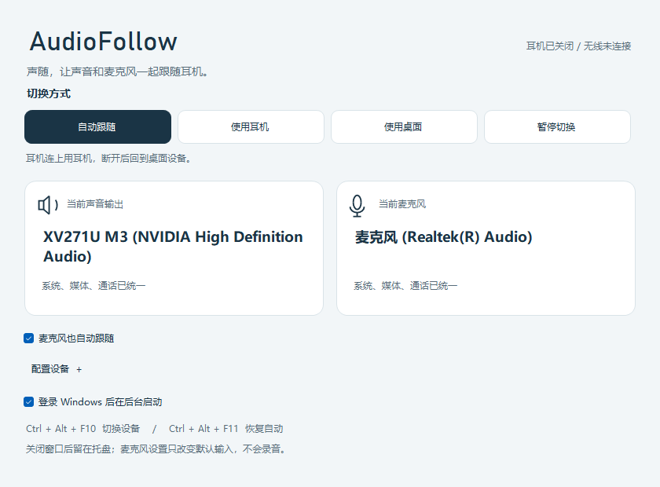

# Barracuda Switch

让 Windows 11 的声音跟随 Razer Barracuda X：耳机连上，用耳机；耳机关闭，回到显示器。接收器可以一直插着。

轻量原生托盘应用，中文界面，无联网服务、无遥测、无需管理员权限。使用 Windows 自带的 .NET Framework 4.8，不需要 Python、Node.js、NuGet 或额外音频插件。



## 下载与安装

从 [最新 Release](https://github.com/lele183/barracuda-switch/releases/latest) 下载 `BarracudaSwitch-v1.1.0-win-x64.zip`，解压到任意目录。仓库为私有时，需要登录获授权的 GitHub 账号。

在解压目录打开 PowerShell，运行：

```powershell
powershell -NoProfile -ExecutionPolicy Bypass -File .\install.ps1 -StartNow
```

安装到 `%LOCALAPPDATA%\Programs\BarracudaSwitch`，自动添加当前用户登录启动，并开始后台运行。双击托盘图标可打开窗口；关闭窗口继续运行，右键托盘图标选择“退出”才停止。

也可以直接双击 `BarracudaSwitch.exe` 使用便携模式。启用登录启动后，请保留程序所在目录。

## 如何切换

| 耳机状态 | 默认播放输出 |
| --- | --- |
| 通过 2.4G 接收器连接 | 扬声器 (7.1 Surround Sound) |
| 关机、无线断开或接收器拔出 | XV271U M3 (NVIDIA High Definition Audio) |
| 检测暂不可用 | 保留当前输出，并继续检测 |

系统、媒体和通信三种默认播放角色一起切换，并回读验证。麦克风和音量不变。在应用中把输出设为“默认 / 跟随系统”；绑定了固定输出的播放器不会随 Windows 默认设置切换。

**硬件范围：Razer Barracuda X 2022，Macronix USB 接收器 `1532:0552`。这是 2.4G 无线连接检测，不是通用蓝牙切换器。** 耳机只连接蓝牙时不会被视为 2.4G 在线。其他设备型号和接收器协议尚未验证。

“设备设置”可选择耳机输出、备用输出和关联音频端点；改好后点击“保存设备”。上述名称是默认值，也可以选择自己的显示器或扬声器。

| 操作 | 快捷键 |
| --- | --- |
| 手动切换耳机 / 显示器 | Ctrl + Alt + F10 |
| 恢复自动模式 | Ctrl + Alt + F11 |

手动模式持续到恢复自动或重启程序。暂停模式保留当前输出。

## v1.1.0 优化

- HID 读取保持挂起，数据到达才唤醒，避免重复分配缓冲区、创建事件和取消读操作。
- 优先使用 Windows 音频设备通知；30 秒一次完整枚举兜底，保留 15 秒只读 HID 状态查询。
- 状态变化立即落盘，空闲心跳改为 30 秒；托盘和窗口只在可见状态变化时刷新。
- 新界面突出实际输出、连接状态和选中的模式，设备配置可展开，支持窗口缩放和键盘操作。

本机一次 30 秒空闲采样中，新版音频枚举和状态写盘各 1 次，句柄稳定；内存约 45 MiB，旧版约 58 MiB。CPU 增量低于该次计时精度，不表示完全不使用 CPU。完整方法和限制见 [性能记录](docs/PERFORMANCE.md)。

## 开发

Windows 11 x64 + .NET Framework 4.8。只使用系统自带 C# 编译器，不下载构建依赖。

```powershell
.\Build.ps1      # dist 中生成程序与安装脚本
.\Test.ps1       # 29 项协议与路由回归检查
.\Preview.ps1    # 离屏 UI 检查；不会访问硬件或改变音频设置
.\Package.ps1    # 构建、测试、ZIP 和 SHA-256
```

CI 在 Windows runner 上执行构建、协议与路由检查并上传发行包。实机验证另见：

```powershell
.\tools\Test-Installed.ps1              # 会短暂切换实际输出，结束后恢复自动
.\tools\Measure-Performance.ps1 -Seconds 30
```

核心目录：`src/` 为原生 WinForms、CoreAudio、HID 和托盘代码；`tests/` 为不依赖硬件的协议测试；`tools/` 为可复现的界面和实机检查。运行数据在 `%LOCALAPPDATA%\BarracudaSwitch`，不会进入 Git。

## 诊断与卸载

```powershell
# 在安装目录运行；--status 从活进程读取，--diagnose 独立回读 Windows 输出
.\AudioSwitchCtl.exe --status
.\AudioSwitchCtl.exe --diagnose
.\AudioSwitchCtl.exe --auto
.\AudioSwitchCtl.exe --refresh

# 移除登录启动、程序和设置；加 -KeepSettings 可保留设置和日志
powershell -NoProfile -ExecutionPolicy Bypass -File .\uninstall.ps1
```

程序通过只读 HID 查询和无线事件判断耳机是否在线，不能只凭 USB 音频端点 Active 判断。状态未知超过 45 秒仍保留当前输出；目标缺失或重名时会提示选择设备，不会随意切换。Windows 默认输出切换使用未公开的 PolicyConfig COM 接口，系统大版本升级后可能需要兼容性更新。

完整操作、命令行参数、故障处理和协议依据见 [中文使用说明](README.zh-CN.md)。历史变更见 [CHANGELOG](CHANGELOG.md)。HID 适配代码及协议来源见 [第三方许可](THIRD-PARTY-NOTICES.txt)。本项目与 Razer Inc. 无关联，发行包未作代码签名。
