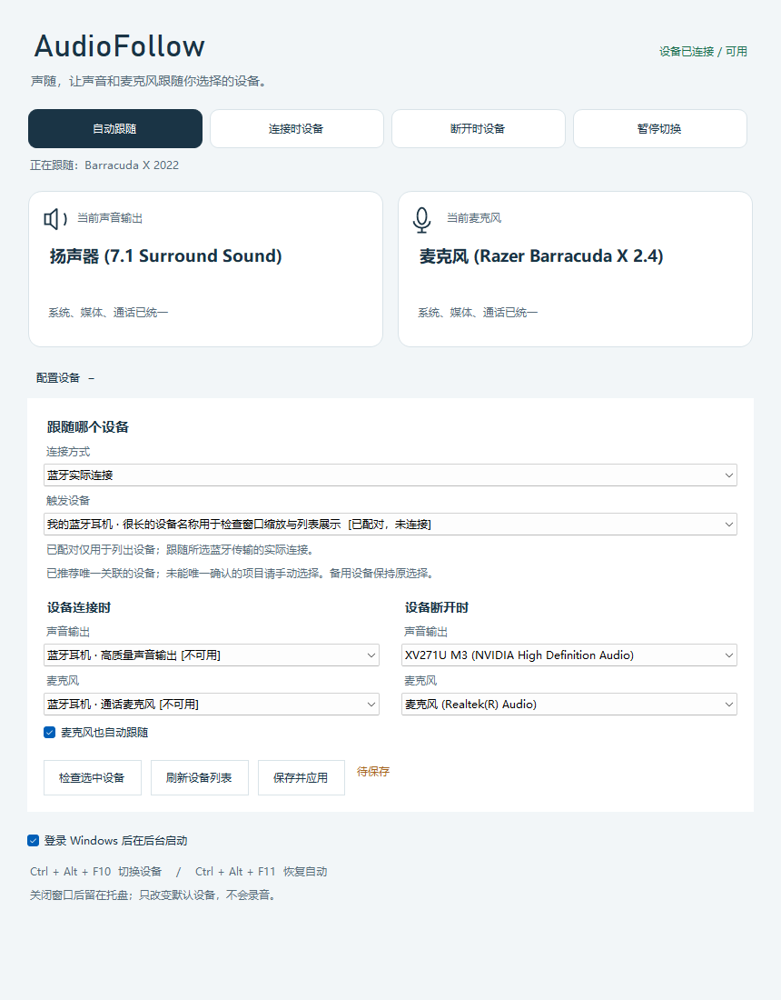

# 声随 · AudioFollow

选择一个触发设备，让 Windows 11 的声音输出和麦克风随连接状态切换。原生中文托盘应用，使用 .NET Framework 4.8，无联网服务、遥测或额外运行时。

**v1.3.0-preview.1 是预览版。** 已完成自动检查和本机状态、路由验证；本轮尚未重新完成耳机物理开关机、USB 物理插拔、蓝牙真实连接/断开及睡眠恢复验收。v1.2.0 稳定版继续保留。详细范围见 [验收记录](docs/ACCEPTANCE-v1.3.md)。



## 下载与安装

从 [v1.3 预览版](https://github.com/lele183/audiofollow/releases/tag/v1.3.0-preview.1) 下载 `AudioFollow-v1.3.0-preview.1-win-x64.zip` 并解压。需要稳定版时使用 [v1.2.0](https://github.com/lele183/audiofollow/releases/tag/v1.2.0)。私有仓库需要登录获授权的账号。

```powershell
powershell -NoProfile -ExecutionPolicy Bypass -File .\install.ps1 -StartNow
```

默认安装到 `%LOCALAPPDATA%\Programs\AudioFollow`，启用当前用户登录启动并在后台运行。双击托盘图标打开设置；关闭窗口后继续运行，托盘菜单“退出”才停止。可直接双击 `AudioFollow.exe` 便携运行。

## 跟随哪个设备

展开“配置设备”，先选择连接方式，再选择触发设备：

| 连接方式 | 连接依据 | 适用范围 |
| --- | --- | --- |
| 专用 2.4G 无线检测 | 已校验的 HID E3 查询和无线事件 | Barracuda X 2022 的 `1532:0552` 接收器，可区分耳机关机与接收器在场 |
| USB 音频设备可用性 | 所选容器的播放/录音端点至少一个可用 | USB 耳机、声卡、扩展坞，支持仅有麦克风的设备 |
| 蓝牙实际连接 | 所选 Windows AEP 设备及传输身份的实际连接属性 | 已配对蓝牙设备；LE 必须关联真实 LE 音频端点，附属电量服务不作为音频连接证据 |

**USB 可用性不能判断一直插着的无线接收器所对应的耳机是否开机。** 其他品牌 2.4G 耳机需要另外适配协议，不能仅替换 VID/PID 后发送现有命令。

分别选择“设备连接时”和“设备断开时”的输出与麦克风。可明确选择“保持当前”，例如蓝牙音箱只切输出。新触发设备只在容器关联唯一时推荐连接目标，多个候选须自行选择；备用输出和备用麦克风保留原选择。

**编辑和“检查选中设备”不会应用配置。** 点击“保存并应用”后才替换检测器；麦克风跟随开关同样需要保存。登录启动复选框单独即时生效。设备列表未完整枚举时可显示已收到的候选，稍后可刷新。

设备按固定标识绑定，名称只用于展示。同名或驱动重装后的设备不会自动替代保存的设备。指定目标暂不可用时保留该方向当前默认设备，并显示错误；另一个方向独立处理。

## 模式与保护行为

- 自动跟随：连接持续 500 毫秒后应用连接组，断开持续 1.5 秒后应用断开组。
- 连接时设备 / 断开时设备：手动固定设备组，直到恢复自动或重启程序。
- 暂停切换：保持当前设备，后台仍更新连接状态。
- 检测未知、初始化未完成或查询失败：保持当前设备，显示原因并重试。
- 睡眠恢复、更换触发器：重新确认连接，旧检测器的延迟回调不能更改新配置。

播放和录音各自的系统、媒体、通信三种默认角色一起设置并回读，切换失败时按原有逻辑回滚。程序不录音、不修改音量。专用 HID 模式保留关联播放设备不可用时回到备用组的兼容保护。

| 操作 | 快捷键 |
| --- | --- |
| 手动切换连接组 / 断开组 | Ctrl + Alt + F10 |
| 恢复自动跟随 | Ctrl + Alt + F11 |

通话和播放软件需要选择“默认 / 跟随系统”。固定绑定设备或已经打开音频流的软件可能需要重新选择设备或重启通话。

## 升级与回退

旧配置自动在内存中升级为专用 HID 检测，保留播放、麦克风和跟随开关。首次保存新版配置前，将原文件原样复制为 `%LOCALAPPDATA%\AudioFollow\settings.json.pre-v1.3.bak`；备份不会被后续保存覆盖。未点击保存时不会重写原配置。

回退到 v1.2.0：退出预览版，保留当前 `settings.json` 副本，将上述备份复制回 `settings.json`，再从 v1.2.0 解压目录运行安装器。若从未保存新版配置，可直接安装稳定版。旧 BarracudaSwitch 程序和设置也继续保留，避免同时运行两版。

## 开发与验证

Windows 11 x64、.NET Framework 4.8、Windows 10/11 SDK（UnionMetadata）及 .NET Framework 4.8 引用程序集。使用系统 C# 编译器，不依赖 NuGet；用户运行发行包不需要 SDK。

```powershell
.\Build.ps1      # dist\AudioFollow
.\Test.ps1       # 88 项离线检查，包含原有 39 项
.\Preview.ps1    # 10 种模拟 UI 布局和交互检查，不改变默认设备
.\Package.ps1    # 构建、离线检查、ZIP、SHA-256
# 以下为主动实机验收，会临时修改真实默认设备；先退出托盘程序
.\tools\Verify-Hardware.ps1 -Run
# 已安装后台程序的性能采样
.\tools\Measure-Performance.ps1 -Seconds 30
```

`src/` 包含 CoreAudio、HID/USB/蓝牙检测器、托盘和界面；`tests/` 为可控制时间的无硬件检查。`build/`、`dist/`、`release/` 和本机诊断、设备 ID 均不提交到 Git。性能记录与限制见 [PERFORMANCE](docs/PERFORMANCE.md)。Windows CI 构建、测试、预览并上传包。

## 诊断与卸载

在安装目录运行：

```powershell
.\AudioSwitchCtl.exe --status       # 活进程状态，包含触发器、原因、稳定状态和观测时间
.\AudioSwitchCtl.exe --diagnose     # 独立回读 Windows 默认设备及当前触发器
.\AudioSwitchCtl.exe --list-triggers Hid
.\AudioSwitchCtl.exe --list-triggers UsbAudio
.\AudioSwitchCtl.exe --list-triggers Bluetooth
.\AudioSwitchCtl.exe --check-trigger .\draft-settings.json  # 只读，不保存、不路由
.\AudioSwitchCtl.exe --headset      # 兼容命令：连接时设备组
.\AudioSwitchCtl.exe --monitor      # 兼容命令：断开时设备组
.\AudioSwitchCtl.exe --auto
.\AudioSwitchCtl.exe --pause
.\AudioSwitchCtl.exe --refresh
powershell -NoProfile -ExecutionPolicy Bypass -File .\uninstall.ps1 -KeepSettings
```

运行数据在 `%LOCALAPPDATA%\AudioFollow`。请勿公开包含本机设备 ID 或蓝牙地址的原始诊断文件。HID 45 秒未得到已验证响应会变为未知；蓝牙复查失败同样保留当前设备。

检测结构见 [TRIGGERS](docs/TRIGGERS.md)，历史见 [CHANGELOG](CHANGELOG.md)，协议与许可见 [第三方声明](THIRD-PARTY-NOTICES.txt)。Windows 默认设备设置使用未公开的 PolicyConfig COM 接口，系统升级后可能需要兼容性更新。本项目与 Razer Inc. 无关联，发行包未作代码签名。